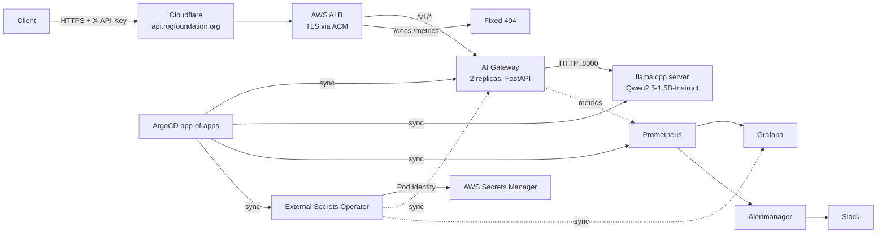
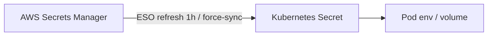

# SecureLLM Platform

A production-oriented, self-hosted LLM inference platform on Amazon EKS: a FastAPI gateway in front of a local llama.cpp model server, deployed entirely through GitOps, with Prometheus/Grafana observability, NetworkPolicy isolation, API-key auth, and secrets sourced from AWS Secrets Manager via External Secrets Operator.

No managed model API, no static AWS credentials in the cluster, no secrets in Git.

## Architecture



| Layer | Implementation |
|---|---|
| Compute | EKS 1.33, managed node groups: `system` (t3.xlarge ×2), `llm-cpu` (m7i.2xlarge, tainted, scale 0→1), optional `gpu` (g5.xlarge, scale 0) |
| Networking | VPC `10.50.0.0/16`, private subnets, one NAT gateway, AWS Load Balancer Controller, ALB Ingress shared via `group.name`, ACM wildcard cert, Cloudflare DNS/WAF |
| Delivery | GitHub Actions → ECR (immutable, scan-on-push) → automatic `newTag` bump → ArgoCD app-of-apps |
| Runtime | FastAPI gateway (auth, rate limiting, metrics) + llama.cpp `server` on a PVC-backed model volume |
| Observability | kube-prometheus-stack, dashboards and alerts as code, 15d retention |
| Secrets | AWS Secrets Manager → External Secrets Operator (EKS Pod Identity) → Kubernetes Secrets |
| Isolation | Default-deny NetworkPolicy in both workloads namespaces (VPC CNI standard enforcement) |

## Repository layout

```
applications/ai-gateway/       FastAPI gateway, providers, Dockerfile
gitops/
  root-app.yaml                App-of-apps entry point
  argocd/                      Child Applications (platform + workloads)
  overlays/dev/demo/           Gateway Deployment, Service, Ingress, PDB, NetworkPolicy, ServiceMonitor
  overlays/dev/models/         llama.cpp server, PVC, Service, NetworkPolicy
  overlays/dev/observability/  Dashboard, PrometheusRule, Grafana Ingress
  overlays/dev/secrets-config/ ClusterSecretStore + ExternalSecrets
infrastructure/
  terraform/                   VPC, EKS, node groups, ECR, ACM, IAM, Pod Identity
  iam/                         GitHub Actions OIDC trust/policy documents
docs/blog/                     Engineering write-up of the build
```

## What's included

- **Gateway** — OpenAI-style `POST /v1/chat/completions`, pluggable providers (`mock`, `vllm`), `/health`, `/ready`, Prometheus `/metrics`.
- **Auth** — `X-API-Key` or `Authorization: Bearer`, SHA-256 hashed keys compared with `hmac.compare_digest`; fail-closed if no keys are configured.
- **Rate limiting** — per-identity token bucket (`RATE_LIMIT_RPM`, `RATE_LIMIT_BURST`), per-pod.
- **Hardening** — non-root, no privilege escalation, dropped capabilities, seccomp `RuntimeDefault`, startup/readiness/liveness probes, `preStop` drain, 25s uvicorn graceful shutdown inside a 30s pod grace period, PDB, zone/host topology spread, rolling updates with `maxUnavailable: 0`.
- **Edge** — API docs, OpenAPI schema and metrics are blocked with an ALB fixed-response `404`; the app itself disables docs unless `DOCS_ENABLED=true`.
- **Alerts** — gateway down, model down, error rate, P95 latency (30s/10m), no traffic, 5xx rate; severity-routed to Slack.
- **Secrets** — Grafana admin, gateway API keys, Slack webhook, and the ArgoCD admin hash are all sourced from Secrets Manager.

## Prerequisites

- AWS account with permissions for VPC, EKS, IAM, ECR, ACM, Secrets Manager
- Terraform ≥ 1.6, AWS CLI v2, `kubectl`, `helm`, `docker buildx`
- A domain on Cloudflare (this deployment uses `rogfoundation.org`)
- GitHub repository with OIDC federation to an IAM role (see `infrastructure/iam/`)

## Bootstrap

### 1. Infrastructure

```bash
cd infrastructure/terraform
terraform init
terraform apply
aws eks update-kubeconfig --name securellm-cluster --region us-east-1
```

Terraform creates the VPC, EKS cluster and addons (`vpc-cni` with NetworkPolicy enabled, EBS CSI, Pod Identity agent), node groups, ECR repositories, the wildcard ACM certificate, and the IAM roles for the load balancer controller and External Secrets Operator.

### 2. Validate the certificate

Add the DNS validation records from `terraform output acm_validation_records` to Cloudflare as **DNS only**, then wait for the certificate to reach `ISSUED`.

### 3. Create the secrets (before ArgoCD syncs)

```bash
# Grafana login
aws secretsmanager create-secret --name securellm/grafana-admin \
  --secret-string '{"admin-user":"admin","admin-password":"<strong-password>"}'

# Gateway API keys: comma-separated name:key pairs
aws secretsmanager create-secret --name securellm/api-keys \
  --secret-string '{"api-keys":"default:<40-hex-chars>"}'

# Slack incoming webhook for Alertmanager
aws secretsmanager create-secret --name securellm/slack-webhook \
  --secret-string '{"webhook-url":"https://hooks.slack.com/services/..."}'
```

### 4. ArgoCD and the app-of-apps

```bash
helm repo add argo https://argoproj.github.io/argo-helm
helm repo update
helm install argocd argo/argo-cd -n argocd --create-namespace

# Store the admin credential as a bcrypt hash so ESO can keep it in sync
PW='<strong-password>'
HASH=$(kubectl -n argocd exec deploy/argocd-server -- argocd account bcrypt --password "$PW")
aws secretsmanager create-secret --name securellm/argocd-admin --secret-string \
  "{\"password\":\"$PW\",\"admin.password\":\"$HASH\",\"admin.passwordMtime\":\"$(date -u +%Y-%m-%dT%H:%M:%SZ)\"}"

# Point at your fork if needed, then bootstrap
kubectl apply -f gitops/root-app.yaml
kubectl -n argocd get applications -w
```

`root` reconciles every Application in `gitops/argocd/`, which in turn deploy the platform (AWS LB controller, observability stack, External Secrets Operator) and the workloads.

### 5. DNS

| Record | Type | Proxy | Target |
|---|---|---|---|
| `api` | CNAME | Proxied | ALB hostname (from `kubectl -n securellm get ingress`) |
| `grafana` | CNAME | Proxied | same ALB |
| `argocd` | CNAME | **DNS only** | same ALB (ArgoCD gRPC breaks behind the proxy) |

## Deploying the gateway

Push to `main` under `applications/ai-gateway/**`. The workflow runs tests, Trivy filesystem and image scans, pushes an immutable image tagged with the commit SHA, then commits the new `newTag` to `gitops/overlays/dev/demo/kustomization.yaml`. ArgoCD rolls it out with `maxUnavailable: 0`.

Manual build (useful on Apple Silicon, where a plain `docker build` produces arm64):

```bash
aws ecr get-login-password --region us-east-1 | \
  docker login --username AWS --password-stdin <account-id>.dkr.ecr.us-east-1.amazonaws.com
docker buildx build --platform linux/amd64 \
  -t <account-id>.dkr.ecr.us-east-1.amazonaws.com/securellm/ai-gateway:<tag> \
  --push applications/ai-gateway
# then bump newTag in gitops/overlays/dev/demo/kustomization.yaml
```

## Using the API

```bash
export SECURELLM_API_KEY=$(aws secretsmanager get-secret-value \
  --secret-id securellm/api-keys --query SecretString --output text | jq -r '."api-keys"' | cut -d: -f2)

curl -s https://api.rogfoundation.org/v1/chat/completions \
  -H "X-API-Key: $SECURELLM_API_KEY" \
  -H 'Content-Type: application/json' \
  -d '{"prompt":"Explain Kubernetes NetworkPolicy in one sentence."}' | jq
```

Responses: `401` missing/invalid key, `429` rate limited, `503` auth misconfigured (no keys loaded), `200` success.

## Observability

- Grafana: `https://grafana.rogfoundation.org` (admin credential in `securellm/grafana-admin`)
- Dashboard: **SecureLLM Overview** (uid `securellm-overview`) — traffic, latency (P50/P95/P99), tokens, errors, auth failures, rate limiting, model up, in-flight requests.
- Metrics exposed by the gateway: `http_requests_total`, `http_request_duration_seconds`, `llm_requests_total`, `llm_request_duration_seconds`, `llm_errors_total`, `llm_prompt_tokens_total`, `llm_completion_tokens_total`, `llm_tokens_total`, `llm_model_up`, `llm_inflight_requests`, `llm_auth_failures_total`, `llm_rate_limited_total`.
- Alerts live in `gitops/overlays/dev/observability/prometheusrule-securellm.yaml`; Slack routing is configured in `gitops/argocd/observability.yaml` (`#securellm-alerts`).

`/metrics` is not publicly reachable: Prometheus scrapes it in-cluster, and the ALB returns `404` for external requests.

## Secrets and rotation



Rotation is a single write to Secrets Manager followed by a forced sync and a restart of the consumer (env vars load at container start):

```bash
aws secretsmanager put-secret-value --secret-id securellm/api-keys \
  --secret-string '{"api-keys":"default:<new-key>"}'
kubectl -n securellm annotate externalsecret securellm-api-keys force-sync=$(date +%s) --overwrite
kubectl -n securellm rollout restart deploy/securellm-ai-gateway
```

Notes:

- ESO refreshes hourly on its own; the annotation just makes it immediate.
- Grafana is pinned to the `grafana-admin` secret via `grafana.admin.existingSecret`, so chart syncs no longer regenerate (and overwrite) the password.
- ArgoCD requires three fields to stay consistent: `password` (human reference), `admin.password` (bcrypt hash), `admin.passwordMtime`. Update all three, then force-sync `argocd-admin`.
- Nothing sensitive is stored in Git or Terraform state.

## Security posture

| Control | Status |
|---|---|
| API authentication, fail-closed | Done |
| Per-key rate limiting | Done (per pod) |
| Admin/API docs and metrics not publicly exposed | Done |
| NetworkPolicy default-deny + explicit allows | Done (VPC CNI enforcement) |
| Non-root, read-only FS, seccomp, dropped caps | Done |
| HA rollout, PDB, probes, graceful drain | Done |
| Secrets in AWS Secrets Manager via Pod Identity | Done |
| Grafana signup/anonymous access disabled | Done |
| ArgoCD bootstrap secret removed, admin rotated | Done |
| Cloudflare-only origin (lock ALB to CF ranges) | Open — needs a dedicated ALB for ArgoCD |
| EKS public endpoint restricted to admin CIDRs | Open |
| Pod Security Admission `restricted`, ResourceQuota/LimitRange | Open |
| CloudTrail, WAF managed rules, image signing | Open |
| Global (cross-replica) rate limiting via Redis | Open |
| HPA on in-flight requests (needs metrics adapter) | Open |

## CI/CD

`.github/workflows/ai-gateway-ci.yml`:

1. **Test** — installs dependencies, runs `pytest` and a smoke import.
2. **Security Scan** — Trivy filesystem scan (fails on HIGH/CRITICAL).
3. **Build and Scan** — builds the image and scans it, failing on HIGH/CRITICAL.
4. **Publish Image to ECR** — assumes `GitHubActions-SecureLLM` via OIDC, pushes SHA-tagged image.
5. **Update GitOps** — rewrites `newTag`, commits, pushes; ArgoCD does the rest.

## Troubleshooting

| Symptom | Cause / fix |
|---|---|
| `exec format error` | arm64 image on x86 nodes. Build with `--platform linux/amd64`. |
| ECR push rejected | Tags are `IMMUTABLE`; use a new SHA/tag. |
| Targets missing in Prometheus | `ServiceMonitor` needs the Service's `metadata.labels` to match `release: kube-prometheus-stack`; the ServiceMonitor selector is not enough. |
| `no matches for kind "ExternalSecret"` | ESO CRDs not installed yet. Sync `external-secrets` first, then `securellm-secrets`. |
| Child Application changes ignored | ArgoCD caches manifests; hard-refresh `root` after editing its Applications. |
| Grafana password reverts on sync | Chart regenerates its own secret; keep `admin.existingSecret: grafana-admin`. |
| ArgoCD unreachable via Cloudflare | Set the `argocd` record to DNS-only. |
| Alertmanager not sending Slack | Webhook is a placeholder; update `securellm/slack-webhook`, force-sync, restart Alertmanager. |

## Roadmap

- Dedicated ALB + Cloudflare IP allowlist for the public API, separate ArgoCD origin
- Pod Security Admission `restricted`, quotas and limit ranges
- Redis-backed global rate limiter; HPA via Prometheus Adapter
- WAF managed rule groups, CloudTrail, image signing/verification
- GPU node group with vLLM for larger models
- Reloader (or a small controller) to restart consumers automatically on secret rotation

## Further reading

- [Running a self-hosted LLM gateway on EKS](docs/blog/2026-10-21-securellm-on-eks.md) — architecture decisions, failures, and lessons learned.
