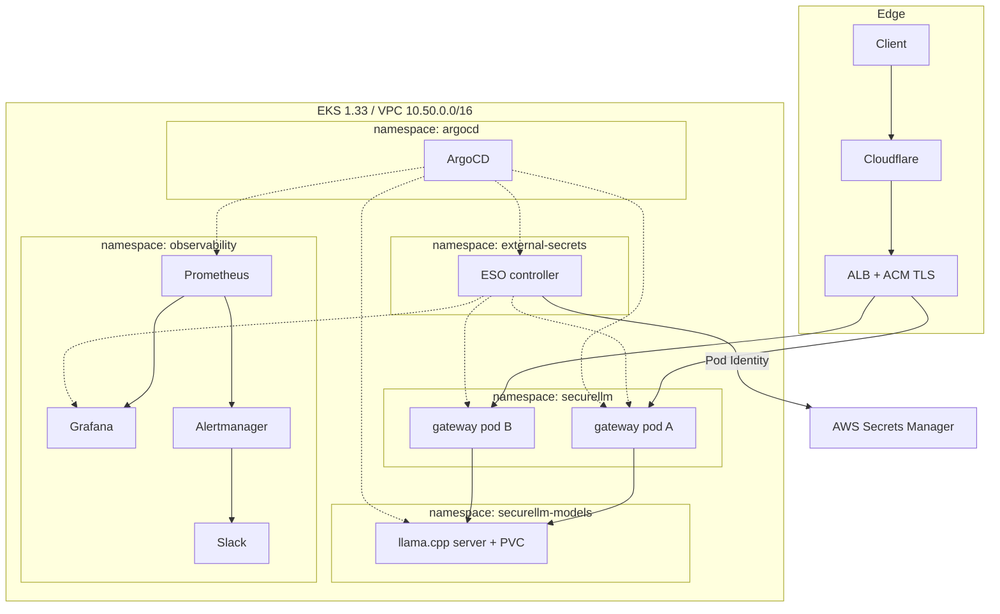

# Running a Self-Hosted LLM Gateway on EKS

Most "deploy an LLM" tutorials stop at a working `curl`. That is the easy part. The interesting problems start when the endpoint has to survive real traffic, real credential handling, real upgrades, and a real 3 a.m. alert — and when the person who built it is not the person who will fix it.

This is a write-up of a small but deliberately production-shaped platform: a FastAPI gateway in front of a locally hosted model, running on EKS, deployed entirely through ArgoCD, observed with Prometheus and Grafana, isolated with NetworkPolicy, and wired to AWS Secrets Manager. It is not a hyperscale design. It is an exercise in making every layer explainable, and in finding out where the sharp edges are.

The most valuable output was not the running stack. It was the list of things that broke in non-obvious ways.

---

## The brief

Requirements were modest on paper:

- Serve a chat-completion endpoint over HTTPS on a custom domain.
- Run the model on our own infrastructure (no external inference API).
- Everything reproducible from Git; no manual `kubectl apply` as a deployment strategy.
- Metrics, dashboards, and alerting from day one.
- No long-lived cloud credentials in the cluster, no credentials in Git.
- Keep the bill sane while idle.

The last constraint shaped the first big decision.

## Architecture



Two node groups matter: a small always-on `system` group carrying the cluster add-ons and platform services, and a tainted `llm-cpu` group that can scale from zero when a model needs to run. A GPU group exists in the same shape for later. The model server and the gateway are separate Deployments in separate namespaces so they can be scaled, isolated, and upgraded independently — and so a runaway gateway cannot starve inference of CPU.

The gateway is reachable only through the ALB; the model server is reachable only from the gateway's namespace. That is enforced, not documented.

## Decision 1: CPU-first inference

A 1.5B-parameter model on CPU is not fast, and pretending otherwise would produce a misleading architecture. What it does give you is a fully functional platform for the price of a mid-size instance, with the GPU path already stubbed out.

The model server is `llama.cpp`'s HTTP server, loading `Qwen2.5-1.5B-Instruct` from a PVC so the download happens once per volume, not once per pod. The Deployment uses `Recreate` (a RWO volume cannot be mounted by two pods), anti-affinity, and a taint/toleration pair so only the model can land on the LLM node.

The gateway is model-agnostic through a two-method interface:

```python
class ModelProvider(ABC):
    @abstractmethod
    def generate(self, prompt: str) -> dict: ...

    def healthy(self) -> bool:
        return True

    @property
    def name(self) -> str:
        return "unknown"
```

Swapping llama.cpp for a GPU-backed vLLM endpoint means changing `MODEL_PROVIDER` and `MODEL_ENDPOINT`. The metrics label comes from `provider.name`, which sounds trivial until you notice that dashboards silently break when the label values change (more on that later).

## Decision 2: The gateway is the product

The gateway is where the security and operability requirements actually live. It does four things beyond proxying:

**Authentication.** Keys are supplied as `X-API-Key` or a bearer token, stored only as SHA-256 hashes, and compared with `hmac.compare_digest`. Multiple named keys are supported (`default:<hex>,partner:<hex>`). If auth is required and no keys are loaded, the service fails closed with `503` rather than silently allowing traffic — a missing Secret must never downgrade to an open endpoint.

**Rate limiting.** A per-identity token bucket (`RATE_LIMIT_RPM=60`, `RATE_LIMIT_BURST=10`) rejects bursts with `429` before they reach the model. The honest caveat: the bucket lives in process memory, so with two replicas the effective aggregate limit is roughly double. That is acceptable for the current traffic and documented rather than hidden; a Redis-backed limiter is on the roadmap.

**Instrumentation.** Every request passes through middleware that records counts, latency histograms, and in-flight gauge; the chat path additionally records model, token usage, and upstream errors. Auth failures and rate-limit rejections have their own counters, because "someone is brute-forcing a key" and "a client is looping" are different incidents.

**Surface reduction.** FastAPI's docs, ReDoc, and OpenAPI schema are disabled unless `DOCS_ENABLED=true`, and `/metrics` is never public. That is enforced twice: in the application, and at the load balancer with an ALB fixed-response action:

```yaml
alb.ingress.kubernetes.io/actions.blocked: >-
  {"type":"fixed-response","fixedResponseConfig":
   {"statusCode":"404","contentType":"text/plain","messageBody":"Not Found"}}
```

with `/docs`, `/redoc`, `/openapi.json`, and `/metrics` routed to the `blocked` annotation backend before the catch-all `/` rule. Prometheus still scrapes `/metrics` in-cluster through the Service; the internet gets a 404 that costs no pod CPU.

## Decision 3: Everything in Git, including the papercuts

The cluster is reconciled by an app-of-apps: a single `root` Application points at `gitops/argocd/`, and every YAML file in that directory is another Application. Platform components (AWS Load Balancer Controller, kube-prometheus-stack, External Secrets Operator) and workloads (gateway, model server, secrets) are siblings. Adding a component is adding a file.

Two operational details were learned the hard way:

1. **ArgoCD caches Application manifests.** Editing a child Application's Helm values does nothing until `root` is hard-refreshed, because the change lives in `root`'s source, not the child's.
2. **Patching an Application can silently discard its sync policy.** A `kubectl patch` that sets `operation.sync` with an empty `syncOptions` clobbers `spec.syncPolicy.syncOptions`. If you automate syncs this way, pass the options explicitly.

The CI pipeline builds on every push to the gateway, runs tests and Trivy (filesystem and image), pushes an immutable SHA-tagged image to ECR, and commits the new tag back into the overlay. ArgoCD takes it from there. ECR immutability is deliberate: a tag always identifies exactly one artifact, and a failed push cannot be "fixed" by silently overwriting it.

## Decision 4: Make failure visible, and only failure

kube-prometheus-stack is deployed with the selectors widened (`ruleSelectorNilUsesHelmValues: false` and friends) so dashboards and rules from the overlay are discovered, and 15-day retention. The dashboard is a ConfigMap in Git, not a click-ops artifact.

The first alerting iteration taught a useful lesson about defaults: EKS does not expose kube-scheduler, kube-controller-manager, or kube-proxy metrics on the ports the upstream chart expects. The result was a permanent low-grade noise floor of "component down" alerts that trained everyone to ignore the channel. Disabling those three scrapes removed the false positives; the alerts that remain are the ones that can actually fire for a real reason.

The latency alert started at a P95 of 5 seconds, which is a reasonable-looking number copied from a web-service template and completely wrong for CPU inference. It now fires at 30 seconds over 10 minutes — slow enough to ignore a single cold start, fast enough to catch a model that has fallen over. Error-rate and 5xx panels use `or vector(0)` so an idle service shows a flat zero rather than "no data", which is the difference between "quiet" and "broken" at a glance.

## Decision 5: Secrets without a second control plane

Kubernetes Secrets are not a secret store. The goal was one source of truth — AWS Secrets Manager — with the cluster as a projection.

External Secrets Operator runs with EKS Pod Identity: the controller's service account is associated with an IAM role scoped to `secret:securellm/*`. No static keys, no IRSA annotation sprawl, no credentials in Git. A `ClusterSecretStore` selects Secrets Manager, and one `ExternalSecret` per consumer projects the value into the Secret the workload already expects.

There is a subtle but important detail in the target policy: `creationPolicy: Merge`. The Grafana chart, for example, generates and owns several keys in its admin Secret. ESO must add `admin-user`/`admin-password` without taking ownership of the rest, or a sync becomes an outage.

The end-to-end rotation loop was tested rather than assumed: change the value in Secrets Manager, force a reconcile, restart the consumer, verify the old credential is rejected and the new one works. That test found two things worth knowing:

- **Grafana's chart regenerates its admin password whenever Helm renders the release** unless `admin.existingSecret` is set. Two consecutive ArgoCD syncs silently changed the password twice. Pinning the existing secret ended the cycle.
- **ArgoCD's admin credential is not a single value.** Rotating it means updating the bcrypt hash *and* `admin.passwordMtime`; `admin.passwordMtime` is what makes ArgoCD accept a new hash. The ExternalSecret therefore syncs both fields from one JSON secret, while the plaintext stays in Secrets Manager purely for humans to read.

After the migration, rotating the gateway API key and the Grafana password was a one-line write to Secrets Manager plus a rollout — no manifest edit, no commit, no password in a terminal scrollback that ends up in a ticket.

## Hardening the runtime

The gateway runs two replicas with `maxUnavailable: 0` and `maxSurge: 1`, spread across zones and hosts, behind a PodDisruptionBudget of `minAvailable: 1`. Probes are separated by intent: `/health` for liveness and startup, `/ready` for readiness. The container runs as non-root with `RuntimeDefault` seccomp, `allowPrivilegeEscalation: false`, and all capabilities dropped.

Graceful shutdown is aligned across layers: `preStop` sleeps 5 seconds so the ALB stops sending new requests, uvicorn is given `--timeout-graceful-shutdown 25`, and the pod's `terminationGracePeriodSeconds` is 30. Without that alignment, in-flight inference requests are killed mid-generation and the client sees a reset — a failure mode that is invisible in average latency and very visible in user complaints.

NetworkPolicy is default-deny in both namespaces, with explicit allows: the gateway accepts traffic only from the VPC CIDR (the ALB targets pods directly) and the observability namespace; it may reach DNS and the model namespace on port 8000. The model accepts only from the gateway namespace, and its egress is DNS plus HTTPS for the initial weight download.

## The failures, in detail

These are the entries worth keeping.

**1. `exec format error` on every pod.** The image was built on an Apple Silicon laptop and pushed to an x86 node group. The fix is `docker buildx build --platform linux/amd64`, and the lesson is that "it runs locally" means nothing across architectures. The CI runner is amd64, but manual builds are exactly when this bites.

**2. A transient ECR push failure stalled the pipeline.** The image build succeeded, the push failed, and because tags are immutable, a retry with the same tag would not have helped. The recovery path was a local cross-platform build and a GitOps tag bump. The real takeaway: CI failure recovery must not depend on the failing step succeeding later.

**3. Prometheus discovered the target but scraped nothing.** The `ServiceMonitor` selector matched the Service, yet `up` stayed absent. The Prometheus Operator's ServiceMonitor discovery uses the *Service's* labels for the `release` relabel, not the ServiceMonitor's. Adding `release: kube-prometheus-stack` to the Service metadata fixed it. This is a two-minute fix that can consume an hour if you only read the ServiceMonitor.

**4. The operator started before its CRDs existed.** Installing kube-prometheus-stack produced a running operator that did not reconcile custom resources until it was restarted after the CRDs were established. ArgoCD's sync ordering is not a CRD readiness guarantee. A `rollout restart` is the unglamorous fix; a sync wave is the sustainable one.

**5. A Grafana password that changed itself.** Covered above, but the general shape is worth naming: any Helm chart that generates a credential at render time is incompatible with GitOps unless you supply that credential from outside the chart. `lookup`-based charts are fine; random generators are not.

**6. `.gitignore` ate two manifests.** A blanket `secrets/` rule excluded an overlay directory. Later, a `*-secrets.yaml` rule silently excluded the External Secrets Operator's Application manifest — so the app-of-apps never created it, ESO was never installed, and the secrets Application sat in `Missing` with a CRD error. Nothing failed loudly; the file simply was not in Git. The fix was a rename. The lesson: after adding manifests, verify with `git ls-files`, not with `ls`.

**7. Rate limits that were twice the configured value.** Two replicas, two in-memory buckets. Correct per pod, misleading in aggregate. Either document it or move the counter to a shared store; do not discover it during an incident.

**8. Both replicas landed on the same node.** The topology spread constraints were correct, but the rollout raced the scheduler before the second node was ready for scheduling. Deleting the pods let the scheduler place them properly. Constraints express intent; they do not guarantee timing.

**9. Unreachable ArgoCD behind Cloudflare.** Proxying gRPC through the orange cloud broke the CLI and UI. The record had to be DNS-only. Edge proxies are opinionated about protocols, and the fix belongs in DNS, not in the ingress.

**10. Public admin surfaces by default.** The observability stack shipped with Grafana signup enabled, anonymous access possible, and Prometheus/Alertmanager ingresses exposed. None of these are exotic vulnerabilities; they are defaults. Every one of them had to be turned off explicitly, and `/metrics` and the API schema had to be blocked at the edge rather than merely undocumented.

## Where it landed

With the hardening in place, a 40-request concurrent burst produced 22 successes and 18 `429`s — the bucket behaving as designed — while normal traffic stayed at `200`. P95 latency for the 1.5B model on CPU settled around 5–6 seconds, which is why the alert threshold is 30 seconds and not 5. Auth failures, rate-limit rejections, token counts, and in-flight requests all show up in Grafana with the model name as a label. The old API key returns `401`; the rotated one returns `200`; the same is true for the Grafana and ArgoCD credentials.

The whole thing reconciles from a single root Application. There is no snowflake resource that exists only because someone once ran a command.

## What is still open

Being explicit about the remaining gaps is part of the design:

- **Origin lock.** The ALB is still reachable directly, which means Cloudflare's WAF can be bypassed. Locking it to Cloudflare IP ranges requires a second ALB (or host-based rules) because ArgoCD is intentionally DNS-only and cannot sit behind the same allowlist. That is a cost/complexity trade-off, not an oversight.
- **EKS public endpoint.** It is open to `0.0.0.0/0`; restricting it needs the operator's egress CIDR, which is easy to get wrong and lock yourself out with.
- **Rate limiting is per pod**, as discussed.
- **No HPA yet.** The metrics are there, but there is no metrics-server/Prometheus Adapter, so scaling on `llm_inflight_requests` is not wired up.
- **Pod Security Admission** is not yet `restricted`, and there are no ResourceQuotas. The pods are already compliant in practice; the namespace labels would enforce it.

## Takeaways

1. **Defaults are not secure defaults.** Signup, anonymous access, docs endpoints, metrics, and open cluster endpoints all required explicit decisions.
2. **GitOps turns configuration drift into a missing-file problem.** Most of the painful failures were ordering or inclusion problems, not code problems. Verify what Git actually contains.
3. **Credential rotation is a workflow, not a value.** The value is the easy part; the restart, the hash format, the MTime field, and the chart that regenerates passwords are the actual work.
4. **Align graceful shutdown across every layer.** ALB deregistration delay, `preStop`, application timeout, and pod grace period are one system.
5. **Observability is subtraction as much as addition.** The most useful alerting change was deleting three scrapes that only ever lied.
6. **A small platform is still a platform.** Two replicas, one model, one domain — and the same failure modes as a large one, just cheaper to reproduce.

The full manifests, Terraform, and gateway code are in the repository. The README covers bootstrap and the operational runbooks; this post is the reasoning behind them.
