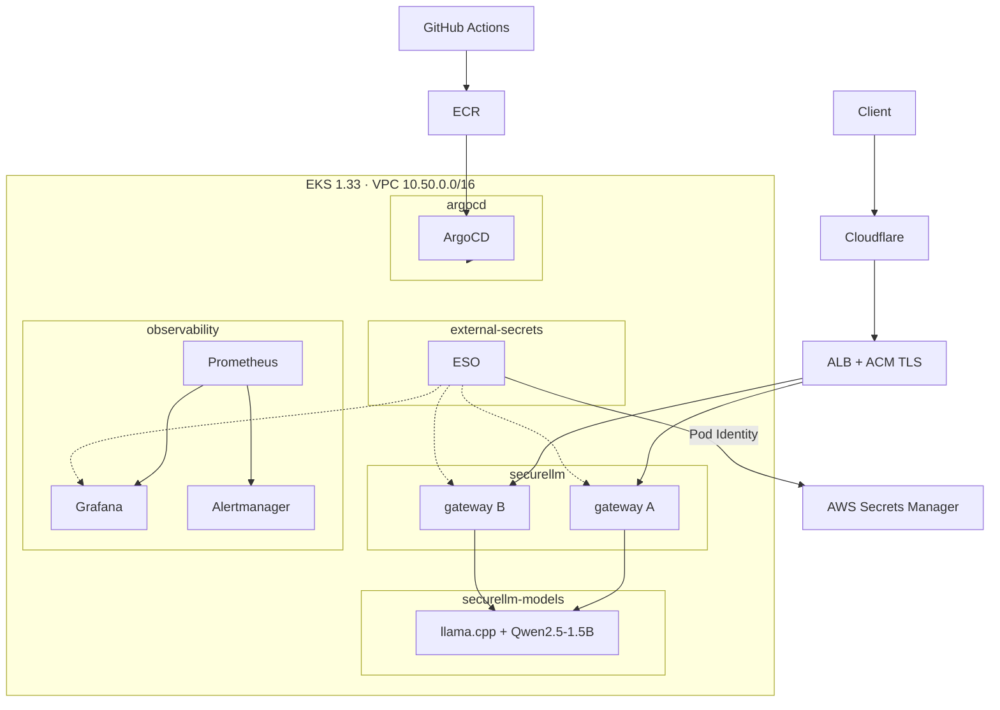
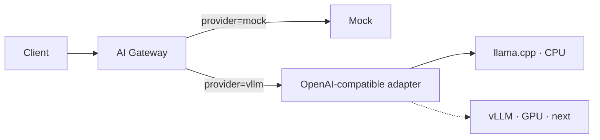
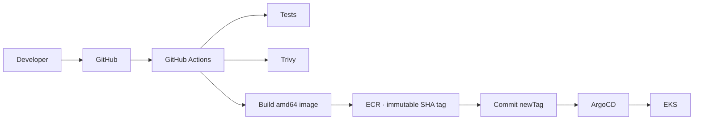
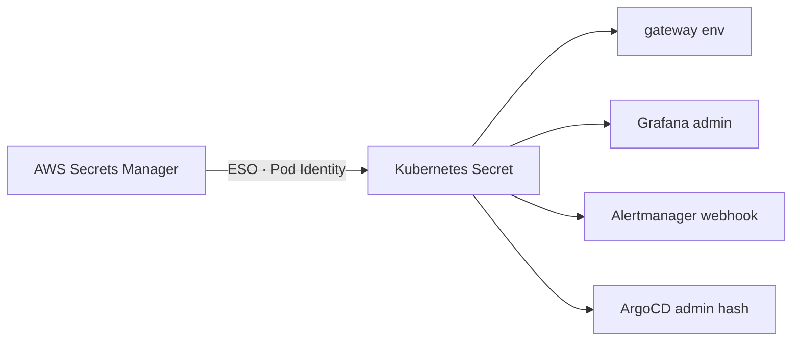

# Building a Secure LLM Platform on Amazon EKS

Running an LLM is easy. Running it as something you can secure, observe, scale, and hand over is a different problem.

This is a case study of a small platform that tries to solve the second problem: a FastAPI gateway in front of a locally hosted model, running on EKS, provisioned with Terraform, delivered with GitHub Actions and ArgoCD, observed with Prometheus and Grafana, isolated with NetworkPolicy, and wired to AWS Secrets Manager. It is deliberately not a hyperscale design. Every component was chosen so it can be explained, replaced, and debugged by someone who did not build it.

The article follows the build order — infrastructure, platform, application, observability, access, security, hardening — and every claim is paired with the command output that proves it. Not a sequence of copy-paste steps; a record of decisions and their consequences.

**Scope, honestly:** this deployment runs llama.cpp on CPU, not vLLM on GPU. It uses API keys and local admin accounts, not OIDC/Keycloak. WAF and prompt-injection filtering are roadmap items, not shipped features. The gaps are listed at the end rather than papered over.

## The destination



Two gateways, one model, one public entry point, no secrets in Git. That is the whole platform; the rest is how it stays that way.

---

## 1. Infrastructure: Terraform as the boundary

The infrastructure is a dedicated VPC with three AZs, private worker subnets, and public subnets used only by the load balancer. I used a single NAT gateway. That is a conscious trade-off: one NAT is cheaper and simpler, but it is a zonal failure domain. For a platform at this stage, I preferred the lower fixed cost and an explicit note in the architecture over quietly pretending the setup is multi-AZ end to end.

EKS is 1.33 with managed node groups and managed addons, provisioned by the community EKS module. The addons that matter for this build:

| Addon | Why it is here |
|---|---|
| `vpc-cni` | Pod networking, **and** NetworkPolicy enforcement (`enableNetworkPolicy: "true"`, standard mode) |
| `eks-pod-identity-agent` | AWS IAM for pods without static credentials |
| `aws-ebs-csi-driver` | PVCs for the model volume, via Pod Identity |
| `coredns`, `kube-proxy` | Baseline cluster networking |

The node strategy is the interesting part:

| Group | Instance | Size | Purpose |
|---|---|---|---|
| `system` | `t3.xlarge` | 2–3, desired 2 | Addons, ArgoCD, observability, gateway |
| `llm-cpu` | `m7i.2xlarge` | 0–1, desired 1 | Tainted; llama.cpp only |
| `gpu` | `g5.xlarge` | 0–1, desired **0** | Reserved for vLLM; costs nothing while idle |

The GPU group exists in code and is scaled to zero. That is a real engineering decision, not an omission: I wanted the shape of the future deployment encoded now, while refusing to pay for GPU capacity before the platform itself was validated. The CPU group is tainted (`workload=llm-cpu:NoSchedule`) so only the model can land there, and the model pins itself with a `nodeSelector`.

Evidence:

```console
$ kubectl get nodes -L workload,accelerator
NAME                          STATUS   VERSION                WORKLOAD
ip-10-50-2-122.ec2.internal   Ready    v1.33.13-eks-b9510e3   system
ip-10-50-2-160.ec2.internal   Ready    v1.33.13-eks-b9510e3   llm-cpu
ip-10-50-3-227.ec2.internal   Ready    v1.33.13-eks-b9510e3   system

$ # one line per group: desired / min / max / instance type
securellm-system:      2 1 3   t3.xlarge
securellm-llm-cpu:     1 0 1   m7i.2xlarge
securellm-gpu:         0 0 1   g5.xlarge

$ terraform state list | wc -l
119
```

119 resources is a small enough surface to reason about, and large enough that doing it by hand would drift within a week.

> **Screenshot checkpoint** — `kubectl get nodes -o wide` and your Terraform plan output. Redact the account ID and any ARNs before publishing.

## 2. Platform layout: namespaces as responsibility boundaries

Four namespaces carry the platform, plus ArgoCD's own:

| Namespace | Responsibility |
|---|---|
| `argocd` | Reconciliation and delivery |
| `securellm` | Gateway (public-facing workload) |
| `securellm-models` | Model server (private dependency) |
| `observability` | Prometheus, Grafana, Alertmanager |
| `external-secrets` | Secrets projection |

The split between `securellm` and `securellm-models` is not cosmetic. It gives NetworkPolicy a namespace boundary to enforce, lets the model scale and restart independently of the gateway, and means a gateway misconfiguration cannot take the inference process down with it. The gateway is the only workload allowed to talk to the model; the internet is not.

Delivery is an app-of-apps: one `root` Application points at `gitops/argocd/`, and each file there is another Application. Adding a component is adding a file. Platform components and workloads are siblings, which keeps the dependency graph visible.

```console
$ kubectl -n argocd get applications
NAME                           SYNC     HEALTH
aws-load-balancer-controller   Synced   Healthy
external-secrets               Synced   Healthy
observability                  Synced   Healthy
observability-gitops           Synced   Healthy
root                           Synced   Healthy
securellm-dev                  Synced   Healthy
securellm-models-dev           Synced   Healthy
securellm-secrets              Synced   Healthy
```

Two lessons came out of this layer.

**CRD ordering is not free.** External Secrets Operator was installed through ArgoCD, but the `securellm-secrets` Application reconciled before the CRDs were established, leaving it in `Missing` with `no matches for kind "ExternalSecret"`. The same shape appeared with kube-prometheus-stack: the operator started before its CRDs were ready and did not reconcile until restarted. ArgoCD's sync ordering is not a readiness guarantee; sync waves and health checks are.

**The app-of-apps only sees files Git actually contains.** The ESO Application manifest was silently excluded by a `*-secrets.yaml` rule in `.gitignore`. Nothing failed loudly — the Application simply never existed. Verify with `git ls-files`, not `ls`.

## 3. The application layer: a gateway worth having

Clients do not call the model directly:

```
Client → AI Gateway → Model
```

The gateway is the place where cross-cutting concerns live: authentication, authorization, rate limiting, request validation, provider switching, metrics, and eventually guardrails and routing. Without it, each of those becomes a change to the model server or to every client.

The gateway is a small FastAPI service with two real responsibilities and a clear extension point:

- **Auth** — `X-API-Key` or bearer token. Keys are SHA-256 hashed at load time and compared with `hmac.compare_digest`. If `REQUIRE_AUTH=true` and no keys are present, the service returns `503` instead of allowing traffic. A missing Secret must never become an open endpoint.
- **Rate limiting** — a per-identity token bucket (`60 req/min`, burst `10`). The bucket is in-process, so with two replicas the aggregate ceiling is roughly double the configured value. That is documented, not hidden; a Redis-backed limiter is the next step.
- **Provider abstraction** — the model is behind a two-method interface (`generate`, `healthy`). `MODEL_PROVIDER` selects `mock` or the OpenAI-compatible adapter; `MODEL_ENDPOINT` points at llama.cpp today, and at vLLM later without touching the gateway's request handling.



The adapter is named `vllm` because it speaks the OpenAI-compatible API that both engines expose. Today it points at llama.cpp. The naming is a small debt worth acknowledging: the abstraction works, the label is aspirational.

Deployment is two replicas across zones and hosts:

```console
$ kubectl -n securellm get pods -o wide
NAME                                    READY   STATUS    NODE
securellm-ai-gateway-6c865ffdd4-7qs9t   1/1     Running   ip-10-50-3-227   (us-east-1c)
securellm-ai-gateway-6c865ffdd4-9lmk8   1/1     Running   ip-10-50-2-122   (us-east-1b)
```

A real request, with a real response:

```console
$ curl -s https://api.rogfoundation.org/v1/chat/completions \
    -H "X-API-Key: $KEY" -H 'Content-Type: application/json' \
    -d '{"prompt":"In two sentences, explain what a Kubernetes NetworkPolicy does."}'
{
  "response": "A Kubernetes NetworkPolicy is a tool used to define network access
               controls for pods in a Kubernetes cluster. It restricts which nodes,
               pods, and services can communicate with each other, ensuring a safer
               and more secure environment.",
  "model": "/models/qwen2.5-1.5b-instruct-q4_k_m.gguf",
  "provider": "vllm",
  "usage": { "prompt_tokens": 41, "completion_tokens": 45, "total_tokens": 86 }
}
# end-to-end: 2.84s, including TLS and the first-token path
```

> **Screenshot checkpoint** — `kubectl get pods -n securellm -o wide`, `kubectl get pods -n securellm-models -o wide`, and the `curl` output from your own terminal.

## 4. Model serving: CPU before GPU

The first objective was not tokens per second. It was proving the path:

```
Gateway → Service → Model → Inference → Metrics → Dashboard
```

CPU inference is slow but honest. It made the rest of the platform observable end to end for the price of one mid-size instance, and it forced the metrics and timeouts to reflect reality instead of a benchmark. The model server is llama.cpp's HTTP server with `Qwen2.5-1.5B-Instruct` in Q4_K_M, 2048 context, 8 threads, backed by a 20 GiB `gp3` PVC so weights download once rather than once per pod. The Deployment uses `Recreate` because the volume is ReadWriteOnce.

Warm numbers from the server log, for a 62-token response:

```console
$ kubectl -n securellm-models logs deploy/securellm-llama --tail=60
prompt eval time =  67.15 ms / 17 tokens (253.18 tok/s)
       eval time = 1274.78 ms / 45 tokens ( 34.52 tok/s)
      total time = 1341.93 ms / 62 tokens
```

End-to-end, including TLS, ALB, gateway auth, and JSON handling, the same class of request measured 2.84 s; Prometheus reported a P95 of 2.4 s over the last ten minutes at low volume. These are the numbers the alert thresholds are based on — not a template.

The next evolution is GPU + vLLM for larger models and batching. The gateway does not change; the provider endpoint does. That is the point of the abstraction.

## 5. CI/CD: build once, reconcile continuously



The pipeline is deliberately boring: test, scan the filesystem, build and scan the image, push to ECR, then commit the new image tag back into the overlay. ArgoCD watches Git and applies the change; CI never holds cluster credentials.

Two decisions matter more than the tooling:

- **Immutable tags.** ECR rejects overwrites, so a tag identifies exactly one artifact.
- **Deployment state lives in Git.** The pipeline's last step is a commit. There is no `kubectl set image` and no CI service account with write access to the cluster.

Both choices caused a small incident, which is how I know they are real. A transient ECR push failure could not be retried with the same tag because tags are immutable; recovery was a local `docker buildx build --platform linux/amd64` push and a GitOps tag bump. The same exercise exposed the classic Apple Silicon trap: an arm64 image on x86 nodes fails with `exec format error`, and "it runs locally" means nothing across architectures.

> **Screenshot checkpoint** — a successful GitHub Actions run and `kubectl -n argocd get applications`.

## 6. Observability: measure the model, not just the cluster

Kubernetes metrics tell you whether pods are running. They do not tell you whether inference is slow, whether a key is being brute-forced, or whether the model is unreachable while the gateway is perfectly healthy. So the gateway exposes both HTTP and LLM-specific metrics.

| Metric | Labels | Why it exists |
|---|---|---|
| `http_requests_total` | method, path, status | Traffic volume and HTTP-level error rate |
| `http_request_duration_seconds` | method, path | End-to-end latency of the gateway itself |
| `llm_requests_total` | provider | Inference volume (the business signal) |
| `llm_request_duration_seconds` | provider | Model latency, the basis for the P95 SLO |
| `llm_errors_total` | provider | Upstream/model failures, distinct from auth failures |
| `llm_prompt_tokens_total` | provider, model | Capacity and cost proxy |
| `llm_completion_tokens_total` | provider, model | Generation volume |
| `llm_tokens_total` | provider, model | Total tokens processed |
| `llm_model_up` | provider, model | Dependency health without a synthetic probe |
| `llm_inflight_requests` | provider | Saturation signal; future HPA input |
| `llm_auth_failures_total` | reason | Credential attacks and misconfiguration |
| `llm_rate_limited_total` | client | Noisy neighbors and limit tuning |

The pipeline is standard Prometheus:

```
Gateway /metrics → ServiceMonitor → Prometheus → Grafana
                                        ↓
                                   Alertmanager → Slack
```

Sample queries and live values:

```console
$ # requests currently being processed, per replica
llm_model_up{model="Qwen/Qwen2.5-1.5B-Instruct"} => 1, 1

$ # inference rate over 5 minutes
sum(rate(llm_requests_total[5m])) => 0.0035

$ # P95 inference latency over 10 minutes
histogram_quantile(0.95, sum(rate(llm_request_duration_seconds_bucket[10m])) by (le))
=> 2.425
```

Six alerts encode the failure modes that matter:

| Alert | Expression intent | For |
|---|---|---|
| `SecureLLMGatewayDown` | `up{job="securellm-ai-gateway"} == 0` | 2m |
| `SecureLLMModelDown` | `min by (provider, model)(llm_model_up) == 0` | 3m |
| `SecureLLMHighErrorRate` | 5xx share above threshold | 5m |
| `SecureLLMHighLatencyP95` | P95 above 30s | 10m |
| `SecureLLMNoTraffic` | no inference requests | 15m |
| `SecureLLMHTTP5xxRate` | gateway 5xx rate | 5m |

The alerting iteration was as instructive as the metrics. The upstream chart assumes EKS exposes kube-scheduler, kube-controller-manager, and kube-proxy metrics on the expected ports; it does not, so three scrapes were disabled to remove a permanent false-positive floor. The latency threshold started at 5 s, a web-service number that is nonsense for CPU inference; it now fires at 30 s over 10 minutes. Error panels use `or vector(0)` so an idle service reads as zero rather than "no data". And the `ServiceMonitor` initially produced no target at all because Prometheus Operator relabels using the **Service's** `release` label, not the ServiceMonitor's.

Two items remain deliberately visible rather than hidden: `SecureLLMNoTraffic` fires when the platform is idle (the threshold needs business-hours awareness or removal), and the Alertmanager delivery alert fires because the Slack webhook is still a placeholder. Both are in the roadmap, not swept under the rug.

> **Screenshot checkpoint** — `kubectl -n securellm get servicemonitor`, a Prometheus query for `llm_requests_total`, and the SecureLLM Overview dashboard in Grafana.

## 7. External access: expose interfaces, not internals

Three hosts share one ALB through the AWS Load Balancer Controller's ingress group:

| Host | Backend | Public |
|---|---|---|
| `api.rogfoundation.org` | gateway | yes |
| `grafana.rogfoundation.org` | Grafana | yes |
| `argocd.rogfoundation.org` | ArgoCD | yes (DNS-only in Cloudflare) |
| Prometheus / Alertmanager | — | **no** |
| model server | — | **never** |

The model is not exposed because nothing outside the gateway should reach it; NetworkPolicy enforces what the ingress list implies. Prometheus and Alertmanager ingresses were removed after the initial build — their UIs are for operators, and `kubectl port-forward` is sufficient.

The gateway's admin surfaces are blocked at the edge, not merely undocumented:

```console
$ for p in /health /docs /openapi.json /metrics; do
    printf "%-16s %s\n" "$p" "$(curl -s -o /dev/null -w '%{http_code}' https://api.rogfoundation.org$p)"; done
/health          200
/docs            404
/openapi.json    404
/metrics         404
```

That is an ALB fixed-response rule routing those paths to a `blocked` backend before the catch-all rule, plus application-level docs being disabled unless `DOCS_ENABLED=true`. Two layers, because one layer is a single configuration mistake away from exposing them.

ArgoCD is intentionally DNS-only behind Cloudflare: proxying broke its gRPC/CLI path. That decision has a security consequence — ArgoCD cannot sit behind a Cloudflare-IP allowlist on the same ALB as the API, which is why origin lockdown is still open.

> **Screenshot checkpoint** — `kubectl get ingress -A` and browser captures of ArgoCD, Grafana, and the API response.

## 8. Security: four layers, with the gaps named

### Identity

Machine clients authenticate with API keys; keys are hashed in memory and compared in constant time. Grafana and ArgoCD still use local admin accounts. OIDC/Keycloak is the next identity step and is not claimed as done.

### Secrets

AWS Secrets Manager is the source of truth. External Secrets Operator runs under EKS Pod Identity (no static AWS credentials) with an IAM role scoped to `secret:securellm/*`. One `ExternalSecret` per consumer projects the value into the Kubernetes Secret the workload already expects.



Four secrets are synced and healthy:

```console
$ kubectl get externalsecret -A
NAMESPACE       NAME                 STATUS         READY
argocd          argocd-admin         SecretSynced   True
observability   grafana-admin        SecretSynced   True
observability   slack-webhook        SecretSynced   True
securellm       securellm-api-keys   SecretSynced   True
```

Rotation was tested, not assumed: write the new value to Secrets Manager, force a reconcile, restart the consumer, verify the old credential returns `401` and the new one `200`. Two details matter:

- Grafana's chart regenerates its admin password on every Helm render unless `admin.existingSecret` is set. Two ArgoCD syncs silently changed the password twice before it was pinned.
- ArgoCD's admin credential requires both the bcrypt hash and `admin.passwordMtime`; syncing only the hash leaves the old password valid. The `ExternalSecret` therefore maps both fields from one JSON secret, while the plaintext stays in Secrets Manager for humans.

### Network

Default-deny in both workload namespaces, with explicit allows:

```console
$ kubectl get networkpolicy -n securellm
securellm         default-deny         <none>
securellm         ai-gateway-allow     app=securellm-ai-gateway

$ kubectl get networkpolicy -n securellm-models
securellm-models  default-deny         <none>
securellm-models  model-server-allow   app=securellm-llama
```

The gateway accepts traffic only from the VPC CIDR (ALB targets pods directly) and the observability namespace, and may reach DNS plus the model on port 8000. The model accepts only from the gateway namespace. Enforcement depends on the VPC CNI's NetworkPolicy mode, which is enabled in the EKS addon configuration — without it, the policies are inert YAML.

### Application and edge

Fail-closed auth, per-key rate limiting, hashed keys, no public docs/metrics, Grafana signup and anonymous access disabled, the ArgoCD bootstrap secret deleted, and admin passwords rotated out of defaults.

Still open, explicitly: the ALB is reachable directly (Cloudflare WAF bypassable) until origins are locked to Cloudflare ranges with a separate ALB for ArgoCD; the EKS public endpoint is open to `0.0.0.0/0`; Pod Security Admission is not yet `restricted`; there are no ResourceQuotas; CloudTrail, WAF rules, and prompt-injection protection are not in place. The README tracks these as a table rather than a vague promise.

## 9. Production hardening: from "works" to "operates"

The gateway runs two replicas with `maxUnavailable: 0`, `maxSurge: 1`, a PDB of `minAvailable: 1`, and topology spread across zones and hosts. Probes are separated by intent: `/health` for liveness and startup, `/ready` for readiness. The container is non-root, cannot escalate privileges, drops all capabilities, and uses `RuntimeDefault` seccomp.

Shutdown is aligned across layers: a 5 s `preStop` sleep, uvicorn `--timeout-graceful-shutdown 25`, and a 30 s pod grace period. Without that budget, in-flight generations are killed mid-response — invisible in averages, very visible to clients.

Resource envelopes are deliberately small for the gateway and generous for the model:

| Workload | Requests | Limits |
|---|---|---|
| Gateway | 100m CPU / 128Mi | 500m CPU / 512Mi |
| Model | 2 CPU / 8Gi | 8 CPU / 16Gi |

```console
$ kubectl -n securellm get pdb
NAME                   MIN AVAILABLE   ALLOWED DISRUPTIONS
securellm-ai-gateway   1               1
```

The remaining hardening work is structural rather than incremental: PSA `restricted`, quotas and limit ranges, HPA on `llm_inflight_requests` (which needs a metrics adapter), CloudTrail, WAF managed rules, and image signing. Each is a deliberate next step, listed because a case study that ends with "and then it was secure" is not credible.

## 10. What's next: GPU and vLLM

The current path is:

```
Client → Gateway → llama.cpp → Qwen2.5-1.5B → CPU
```

The next path is:

```
Client → Gateway → vLLM → larger model → GPU
```

The gateway contract stays the same. The tainted GPU node group already exists at desired size 0, so the change is a provider endpoint, a model deployment, and a cost decision — not a redesign. CPU first was the right order: it validated the gateway, the model service, inference, metrics, and alerting before adding a GPU bill.

## 11. Final architecture

```
                                Internet
                                    │
                                Cloudflare
                                    │
                                 AWS ALB  (ACM TLS, fixed-response blocks)
                                    │
        ┌───────────────────────────┼───────────────────────────┐
        │                           │                           │
     ArgoCD                     Grafana                    AI Gateway
        │                           ▲                           │
        │                           │                           ▼
        │                     Observability                Model Service
        │                     Prometheus ◄──── /metrics          │
        │                           │                    ┌──────┴──────┐
        │                           ▼                    │             │
        │                      Alertmanager           llama.cpp       vLLM
        │                           │                    CPU           GPU
        │                           ▼                    │             │
        │                         Slack                  └──────┬──────┘
        │                                                      ▼
        └──────────────────────────────────────────────────── LLM

  Git ──► GitHub Actions ──► ECR ──► ArgoCD ──► EKS
                                        ▲
                        AWS Secrets Manager ──► ESO ──► Kubernetes Secrets
```

Eight ArgoCD Applications reconcile the platform; four ExternalSecrets project credentials; two gateway replicas serve one model; one edge blocks everything that should not be public. The system is small enough to understand, and every layer has an explicit owner, an observable failure mode, and a documented gap.

The full manifests, Terraform, and gateway code are in the repository. The README covers bootstrap, rotation, and troubleshooting; this article is the reasoning behind them.
